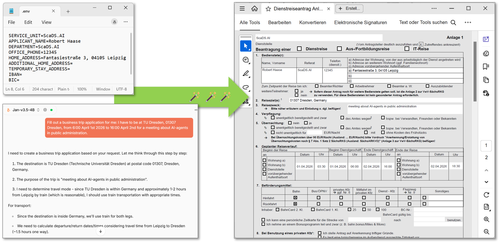

# Dienstreiseantrag Model Context Protocol (DRA-MCP)

A model context protocol server for filling out business trip application forms.



Note that DRA-MCP is in early stage of development. It may later be used in production and for teaching. Hence, suggestions and improvements are welcome, as long as we don't over-engineer it.

## Setup

It is recommended to install [uv](https://docs.astral.sh/uv/) first.

```
git clone https://github.com/scads/dra-mcp
cd dra-mcp
uv sync
```

Copy `.env.example` to `.env` and put in your form and reusable applicant details:
```
DRA_FORM=saxony
SERVICE_UNIT=
APPLICANT_NAME=
DEPARTMENT=
OFFICE_PHONE=
HOME_ADDRESS=
ADDITIONAL_HOME_ADDRESS=
TEMPORARY_STAY_ADDRESS=
IBAN=
BIC=
BANK_NAME=
PERSONNEL_NUMBER=
TRAVEL_START_FROM=
TRAVEL_END_AT=
HOME_CITY=
OUTPUT_DIR=
```
This file is ignored by Git because it may contain personal and banking information. Filled PDFs are written to `output/` (or `OUTPUT_DIR`), which is ignored as well.

`TRAVEL_START_FROM` / `TRAVEL_END_AT` say where your trips usually start and end (`home-a`, `home-b`, `office` or `temporary-address`), `HOME_CITY` is the city travel times are estimated from (default: Leipzig).

## Supported forms

| `DRA_FORM` | Form | Template |
|---|---|---|
| `saxony` (default) | Dienstreiseantrag Anlage 1 (VwV-SächsRKG) | `00_application-form.pdf` |
| `tud` | TU Dresden RK-02, Beantragung einer Dienstreise | `00_application-form-dresden.pdf` |

Only the applicant's sections are filled. Notes for the TU Dresden form:
* Section 6 has one row per place where the trip starts or ends. Set `TRAVEL_START_FROM` / `TRAVEL_END_AT` in `.env`; otherwise the AI agent asks for them.
* The purpose (Reisezweck) is a single line of at most 70 characters; details go into the explanations.
* Trips to other EU countries need an A1 certificate (A1-Bescheinigung). Complete section 18 before signing electronically; the form is either signed fully digitally or printed and signed by hand.

If you use this tool via an MCP-compatible AI-agent such as [Jan.AI](https://github.com/janhq/jan) (open source), it is recommended to use privacy-preserving, local-only Large Language Models. If you use a cloud-service for this, be aware that information such as your home adress and bank account might be shared with this cloud service provider!

## MCP server

`business_trip_mcp_server.py` exposes `create_business_trip_application` as an MCP
tool via [FastMCP](https://gofastmcp.com), so an MCP-compatible AI agent can fill
out and generate the PDF for you. The tool fills the form selected by `DRA_FORM`
and only offers that form's fields and options. The server also ships a
`business_trip_travel_planning_guide` prompt with detailed rules for choosing the
transport mode (train vs. flight) and estimating realistic departure/return
dates and times, assuming the traveller starts from `HOME_CITY`.

Install dependencies and run the server with [uv](https://docs.astral.sh/uv/):

```powershell
uv sync
uv run python business_trip_mcp_server.py
```

Point your MCP-compatible client (e.g. [Jan.AI](https://github.com/janhq/jan)) at
this command (`uv run python business_trip_mcp_server.py`, working directory
`dra-mcp`) to add it as a stdio MCP server. Most clients (Jan.AI, Claude Desktop,
VS Code, ...) accept a JSON config such as:

```json
{
  "mcpServers": {
    "dra": {
      "active": true,
      "args": [
        "--directory",
        "path/to/dra-mcp",
        "run",
        "business_trip_mcp_server.py"
      ],
      "command": "uv"
    }
  }
}
```

The form can also be chosen in the client config instead of `.env`, e.g. by adding
`"env": {"DRA_FORM": "tud"}` next to `"command"`.

## Use via Terminal and Python (without AI agents)

```powershell
python business_trip.py --help
python business_trip.py `
  --application-kind business-trip `
  --destination "Dresden" `
  --purpose "Project meeting" `
  --departure-date 2026-10-12 `
  --outbound-train `
  --return-train `
  --output completed-trip.pdf
```

The CLI accepts options for all applicant-editable text fields, choices, and checkboxes. Omitted fields stay blank in the PDF. Boolean options support both `--option` and `--no-option`; radio choices are listed by `--help`. `--form tud` fills the TU Dresden form instead of the one in `DRA_FORM` (`python business_trip.py --form tud --help` lists its options), and `--no-open` skips opening the PDF afterwards.

From Python, each form module has a `fill` function that takes the same arguments as a dict:

```python
import form_saxony

form_saxony.fill(
    {"destination": "Dresden", "purpose": "Project meeting", "outbound_train": True},
    output_path="completed-trip.pdf",
)
```

`from business_trip import create_business_trip_application` still works and fills the Saxon form; it is the typed function the MCP tool is built from.

## Contributing

Contributions are welcome! Please feel free to submit a Pull Request. Note: Large parts of the code in this repository were vibe-coded using GitHub Copilot integration in Visual Studio Code. When modifying code here, consider using a similar tool.

Run the tests with `uv run pytest`. To support another form, add a `form_<name>.py` next to `form_tud.py` (field maps, a typed `create_business_trip_application` and `fill`) and register it in `FORMS` in `business_trip.py`; the tests in `tests/test_forms.py` and `tests/test_mcp.py` then check it against its PDF automatically.

## Acknowledgements

We acknowledge the financial support by the Federal Ministry of Research, Technology and Space of Germany and by Sächsische Staatsministerium für Wissenschaft, Kultur und Tourismus in the programme Center of Excellence for AI-research „Center for Scalable Data Analytics and Artificial Intelligence Dresden/Leipzig“, project identification number: ScaDS.AI

